# MiniGeoportal

[](https://github.com/envirosolutionspl/minigeoportal/actions/workflows/image.yml)
[](https://github.com/envirosolutionspl/minigeoportal/pkgs/container/minigeoportal)
[](https://minigeoportal.pl)
[](package.json)
[](LICENSE)

**Działki, plany miejscowe i ortofotomapa na prostej, szybkiej mapie.** MiniGeoportal pokazuje publiczne dane z geoportal.gov.pl osobom, które nie pracują z mapami zawodowo, na komputerze i na telefonie. Działa na [minigeoportal.pl](https://minigeoportal.pl).

_A simple, fast web map for public map services. Documentation in English: [docs/en](docs/en/README.md)._

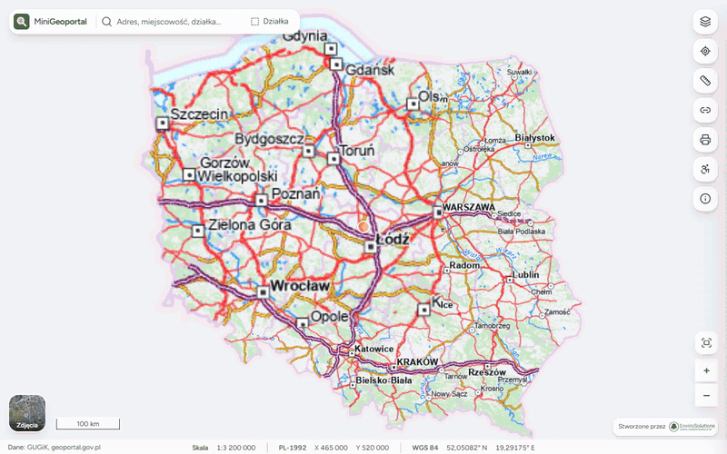

## Co potrafi

- **Wyszukiwarka** adresów, miejscowości i obiektów; działkę znajdzie też po numerze i obrębie, a punkt po współrzędnych.
- **Informacje o miejscu** po kliknięciu w mapę: działka z ewidencji gruntów, przeznaczenie w planie miejscowym i dane innych włączonych warstw, z linkiem do **raportu o działce** na geoportal.gov.pl. Gdy warstwa odpowiada dopiero przy większym przybliżeniu, panel mówi, od jakiej skali, i przybliża mapę jednym przyciskiem.
- **Ponad 400 warstw** geoportal.gov.pl w jednej liście z wyszukiwarką i tematami, z przezroczystością i wyborem podwarstw. Przy warstwach, których nie da się pokazać, jest wyjaśnienie „Dlaczego?”.
- **Menu kontekstowe** (prawy przycisk myszy albo przytrzymanie palca): kopiuje współrzędne w PL-1992 i WGS 84 i prowadzi do miejsca w Google Maps.
- **Pomiar** odległości i powierzchni, **wydruk** w skali na A4 lub A3 (także do PDF) i **link** do bieżącego widoku mapy.
- **Podkłady**: mapa i ortofotomapa z datą zdjęcia, przełączane jednym kliknięciem.
- **Podróż w czasie**: archiwalne ortofotomapy GUGiK od 1995 r. i skany map topograficznych w układach 1942, 1965 i 1992 (od lat 50.). Suwak pokazuje tylko daty, z których są zdjęcia w oglądanym miejscu (ze skorowidza ortofotomap), a przycisk „Porównaj” dzieli mapę kurtyną: po lewej wybrana data, po prawej dziś. Link do widoku niesie datę, więc „jak to wyglądało w 2007” da się wysłać. W panelu miejsca liczba zdjęć z archiwum prowadzi prosto do podróży.
- **Telefon**: panele na cały ekran, przytrzymanie palca zamiast prawego przycisku, przycisk „Moja lokalizacja”.
- **Dostępność** na poziomie WCAG 2.1 AA, z wyjątkami opisanymi w deklaracji dostępności: obsługa klawiaturą (także pomiaru i menu miejsca), czytniki ekranu, tryb ciemny, powiększenie tekstu i wysoki kontrast. Interfejs po polsku i angielsku.

## Zrzuty ekranu

|                                        | Komputer                                                            | Telefon                                                            |
| -------------------------------------- | ------------------------------------------------------------------- | ------------------------------------------------------------------ |
| Wyszukiwarka adresów                   | 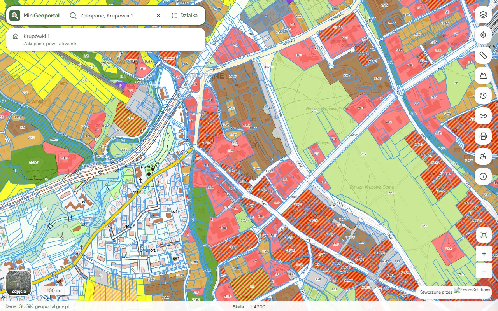 | 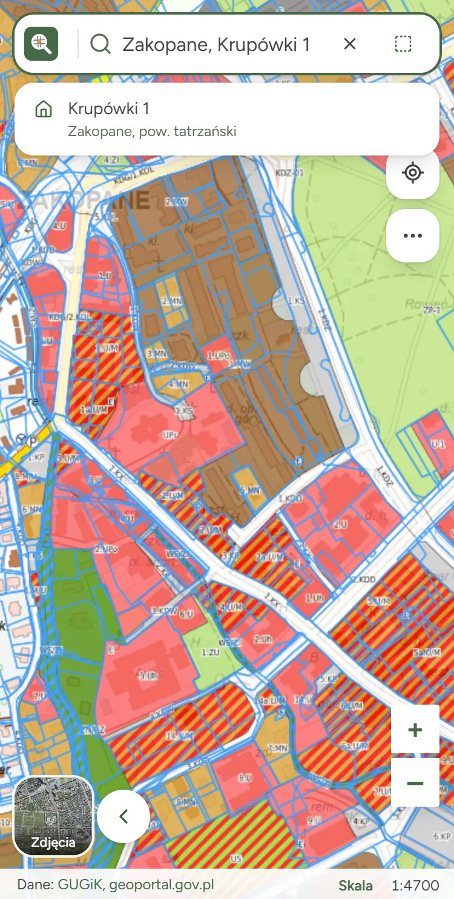 |
| Wyszukiwarka działek                   | 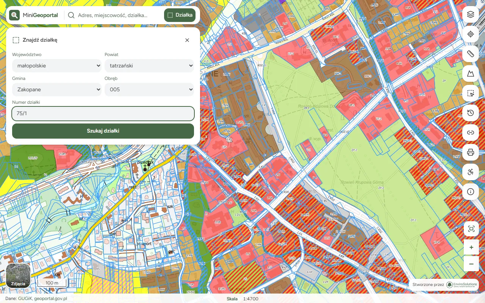 | 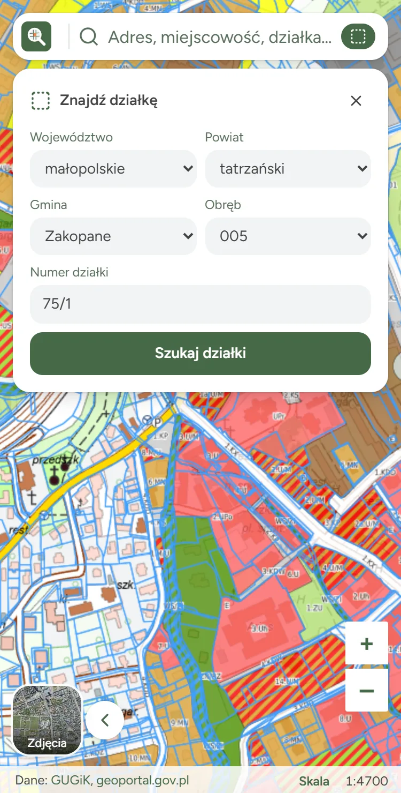 |
| Znaleziona działka                     | 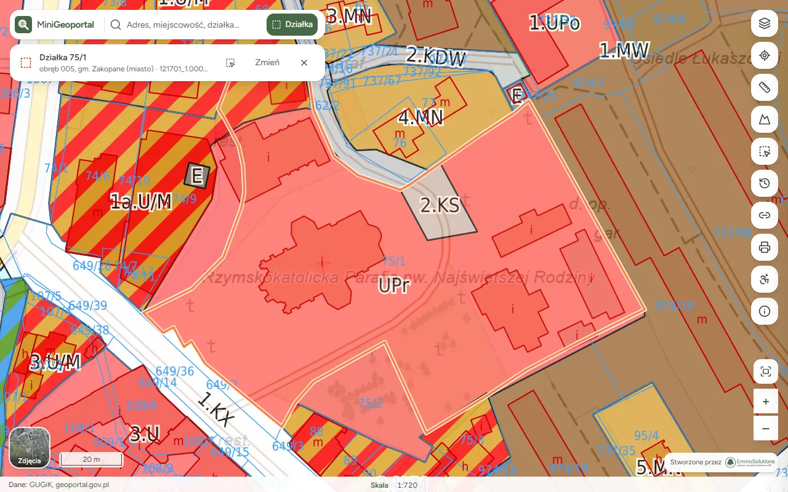   | 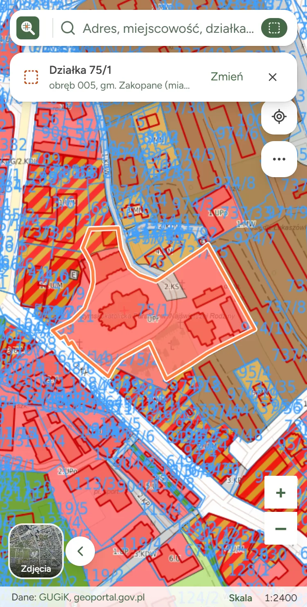   |
| Informacje o miejscu, raport o działce | 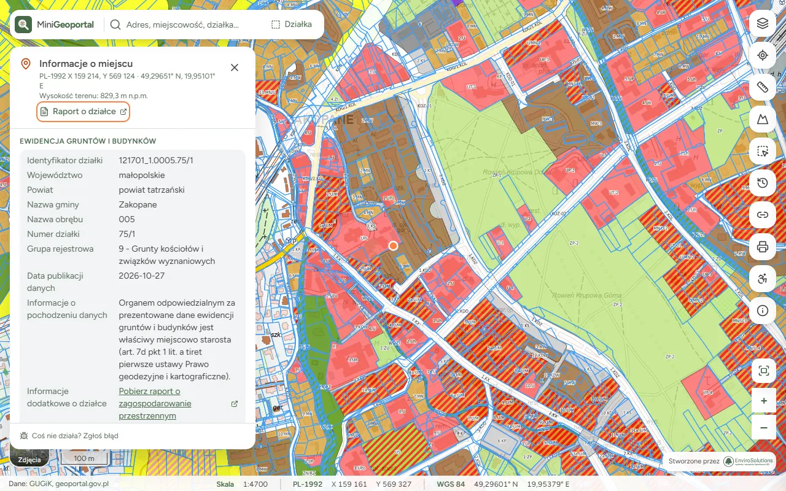     | 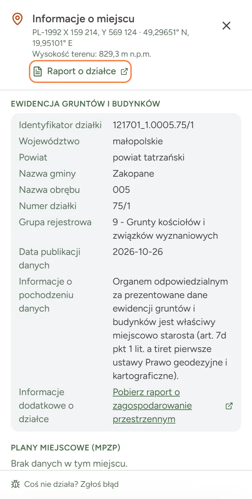     |
| Menu kontekstowe                       | 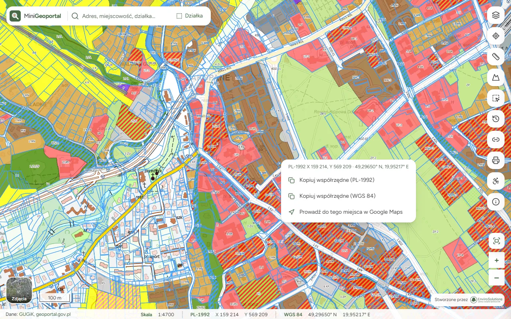     | 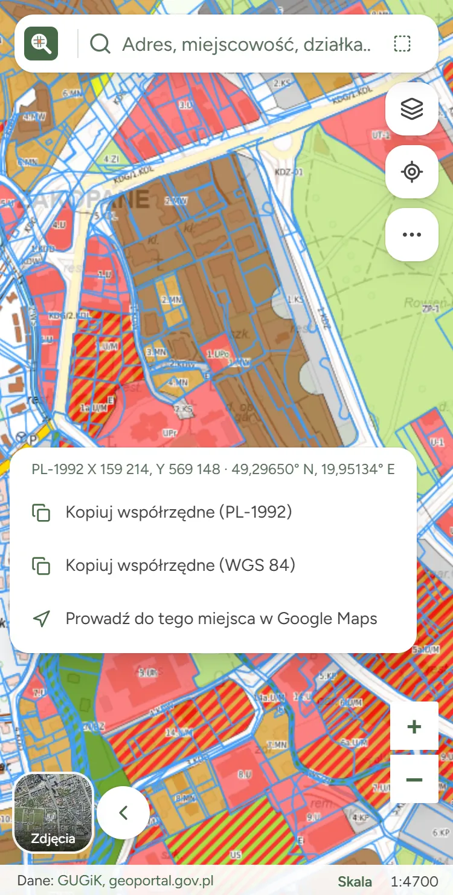     |
| Lista warstw                           | 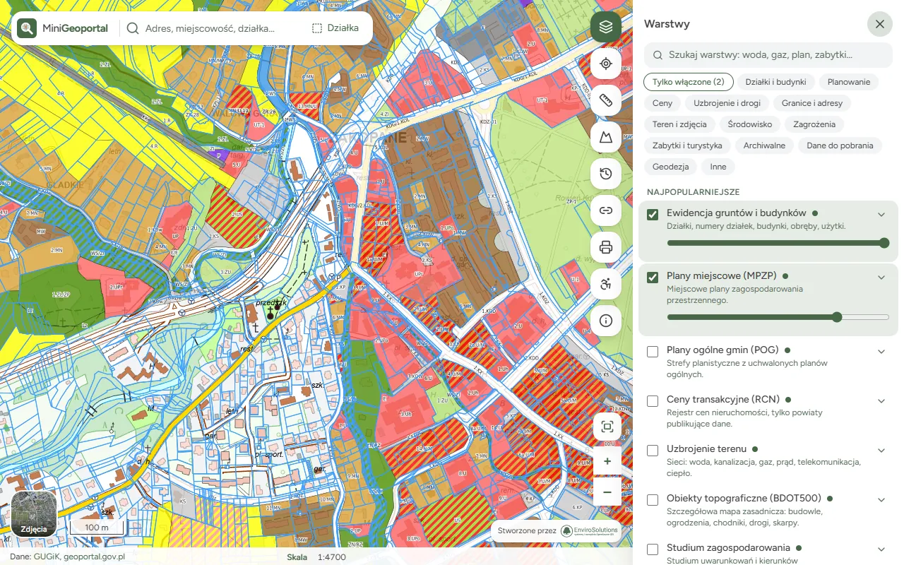              | 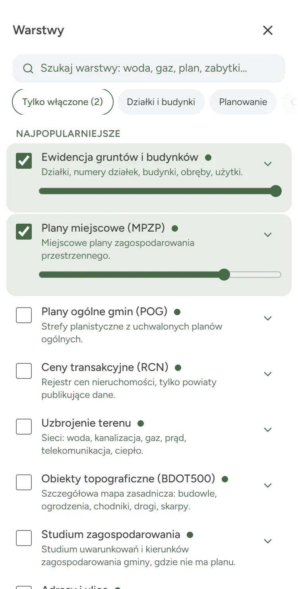              |
| Podróż w czasie: 2007 i dziś           | 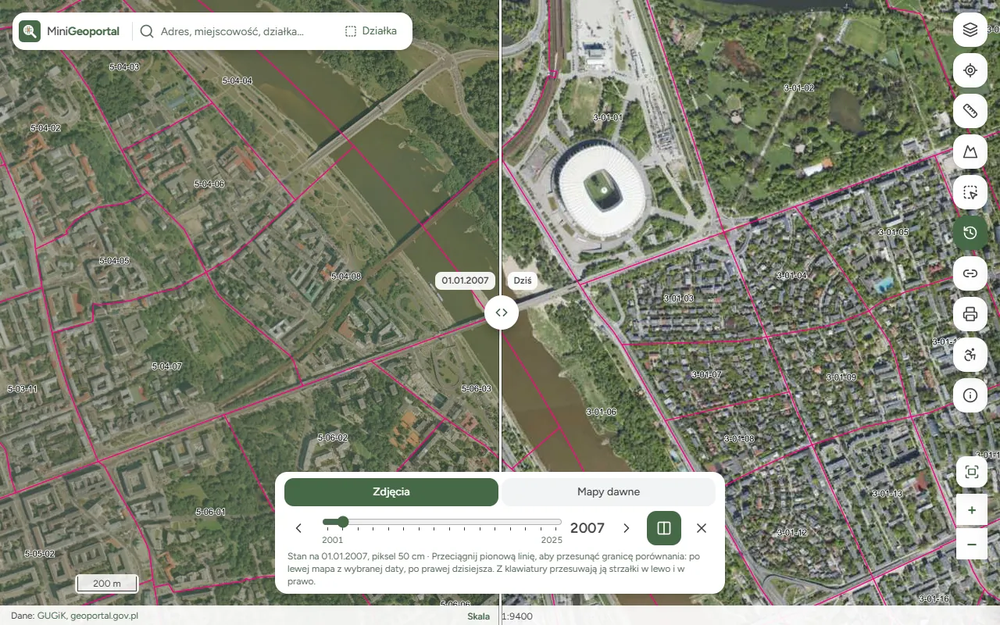      | 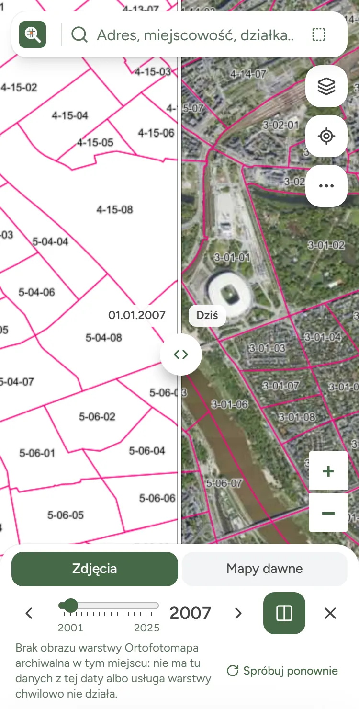      |

Link „Raport o działce” (obwiedziony na zrzutach) otwiera raport geoportal.gov.pl dla klikniętej działki, z wydrukiem i zapisem do PDF:

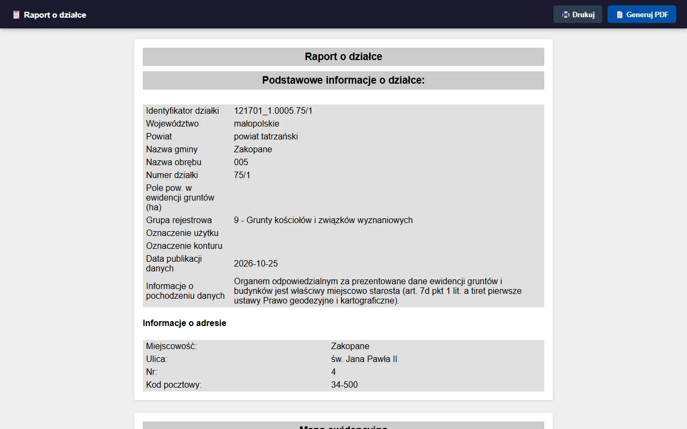

## Własna mapa

Jedna aplikacja obsługuje dowolny zestaw usług mapowych (WMS, WMTS, ArcGIS REST, kafle XYZ) w dowolnym układzie współrzędnych. Wdrożenie to katalog plików YAML i Markdown, bez zmian w kodzie. W repozytorium są dwa:

- `config/`: [minigeoportal.pl](https://minigeoportal.pl), usługi GUGiK w układzie PL-1992 z modułem `gugik` (działki, plany, ceny transakcyjne, uzbrojenie terenu, ortofotomapa, katalog warstw geoportalu).
- `examples/osm/`: OpenStreetMap w Web Mercator, wyszukiwarka Nominatim i jedna warstwa WMS, bez usług GUGiK. Dobry punkt wyjścia dla własnego wdrożenia.

## Szybki start

Wymaga Node.js 22.18 lub nowszego.

```bash
git clone https://github.com/envirosolutionspl/minigeoportal.git
cd minigeoportal
npm install
npm run dev                            # wdrożenie z config/, aplikacja na porcie 5173
CONFIG_DIR=examples/osm npm run dev    # inne wdrożenie
```

Na serwer: gotowy obraz Dockera `ghcr.io/envirosolutionspl/minigeoportal` z Caddy albo za istniejącym nginx, opisany w [Wdrożeniu](docs/pl/wdrozenie.md).

## Dokumentacja

| Polski                                                    | English                                                |
| --------------------------------------------------------- | ------------------------------------------------------ |
| [Przegląd](docs/pl/README.md)                             | [Overview](docs/en/README.md)                          |
| [Pierwsze wdrożenie](docs/pl/pierwsze-wdrozenie.md)       | [First deployment](docs/en/first-deployment.md)        |
| [Konfiguracja](docs/pl/konfiguracja.md)                   | [Configuration](docs/en/configuration.md)              |
| [Treści i języki](docs/pl/tresci-i-jezyki.md)             | [Texts and languages](docs/en/texts-and-languages.md)  |
| [Skórki](docs/pl/skorki.md)                               | [Skins](docs/en/skins.md)                              |
| [Wyszukiwarka i moduły](docs/pl/wyszukiwarka-i-moduly.md) | [Search and modules](docs/en/search-and-modules.md)    |
| [Warstwy zmienne w czasie](docs/pl/warstwy-czasowe.md)    | [Layers that change over time](docs/en/time-layers.md) |
| [Wdrożenie](docs/pl/wdrozenie.md)                         | [Deployment](docs/en/deployment.md)                    |
| [Architektura](docs/pl/architektura.md)                   | [Architecture](docs/en/architecture.md)                |

## Licencja i dane

Projekt open source na licencji MIT, tworzony przez [EnviroSolutions](https://envirosolutions.pl). Aplikacja pobiera dane na bieżąco z usług wskazanych w konfiguracji i ich nie przechowuje; za dane odpowiadają ich wydawcy, a informacje mają charakter poglądowy.
