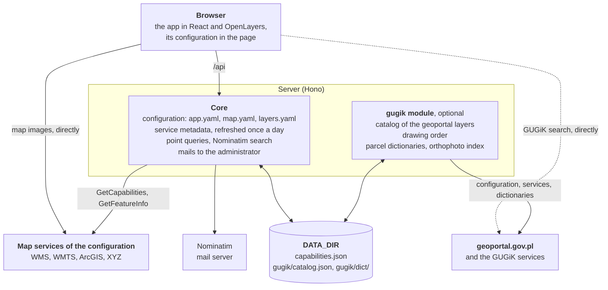
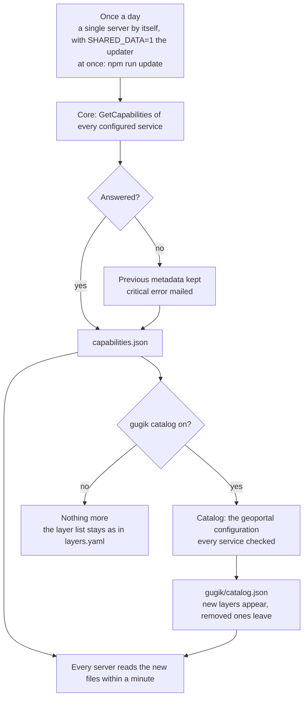

# Architecture

## How it is built

The gugik module and its connections are there only when `app.yaml` turns it on; the dashed line is its search, which the browser asks directly.

- `src/`: the app in React 19, TypeScript and OpenLayers 10, styled with Tailwind CSS. It gets its configuration in the page itself (`src/config/runtime.ts`), without one more request.
- `server/`: a light server (Hono) without a database: the configuration (`server/config/`), the cache of service metadata and its daily refresh, the proxy of point queries, the Nominatim search, mails to the administrator (bug reports and critical errors).
- `server/modules/gugik/` and `src/modules/gugik/`: the optional integration with geoportal.gov.pl: the catalog of every geoportal layer built from its configuration and checked service by service, the drawing order, the dictionaries of the parcel search, the orthophoto index, the GUGiK search, the link to the parcel report.
- `i18n/`: interface texts (pl, en); `skins/`: skins shipped with the app.
- `Dockerfile`, `compose.yaml`, `deploy/caddy/`: containers with Caddy; `compose.proxy.yaml`, `deploy/nginx/`: the variant behind an existing nginx.

The browser fetches the services' images straight from their servers, in the map's system, so it reprojects nothing. Only point queries (place information), dictionaries and the Nominatim search go through the server.

## Data and refresh

| Data                                                                                         | Where                           | Refreshed                                                                     | Part                    |
| -------------------------------------------------------------------------------------------- | ------------------------------- | ----------------------------------------------------------------------------- | ----------------------- |
| Metadata of the configured services: scale limits, legends, place information formats, dates | `<DATA_DIR>/capabilities.json`  | once a day, `npm run update` at once                                          | core                    |
| Drawing order of the geoportal maps                                                          | `<DATA_DIR>/capabilities.json`  | with the metadata                                                             | gugik (`drawOrder`)     |
| Catalog of the geoportal layers                                                              | `<DATA_DIR>/gugik/catalog.json` | with the metadata                                                             | gugik (`catalog`)       |
| Dictionaries of the parcel search (TERYT)                                                    | `<DATA_DIR>/gugik/dict/`        | after 30 days (an empty list after 6 hours), in the background when asked for | gugik (`search.parcel`) |
| Layers of the orthophoto index                                                               | memory                          | after 24 hours                                                                | gugik (`ortho`)         |

Once a day means: a single server refreshes the data itself; with a shared data directory (`SHARED_DATA=1`) the `updater` service of Compose does it. Every server reads the new files within a minute. A service that does not answer keeps its previous metadata and is a critical error, mailed to the administrator (see [Deployment](deployment.md#critical-errors)).

The core never changes the layer list: it is the list of `layers.yaml`, and the refresh only fills in the metadata of the layers named there. A layer the service adds does not appear, one it removes stays on the list. Only the catalog of the gugik module follows geoportal.gov.pl: layers added there appear on the list, removed ones leave it, and layers whose service does not answer are greyed out with the reason. With the module off the daily refresh reads only the metadata of the configured services: a few requests a day.

## Security

The API has no accounts and no user data.

- The server connects to service addresses only after checking that they are http(s) on a usual port and that the host resolves to public addresses (on every redirect too), so it cannot be used to reach an internal network.
- Point queries accept only services of the configuration or the catalog, and every parameter is checked and rebuilt; answers are read with limits on size and time.
- Rate limits per client address and a limit of parallel connections to the upstream services; the Nominatim search sends at most one request a second. Details: [Deployment](deployment.md#running-the-server).
- `app.yaml`, `map.yaml` and `layers.yaml` cannot hold secrets (keys that look like passwords and tokens are refused), and Markdown texts cannot insert HTML or scripts.
- Headers: a Content Security Policy built from the configuration, `frame-ancestors 'none'`, `nosniff`, `Referrer-Policy`, `Permissions-Policy`.

## Quality

`npm run check` runs the type check, ESLint (TypeScript, React hooks and accessibility rules), Prettier and the tests (Vitest): the server's in Node, the app's in jsdom. The tests cover the WCAG rules of axe-core, the contrast of every skin, complete translations and a description of every configuration field in the documentation. Every change comes with its test in the same commit.

## Data

The app fetches data live from the services named in its configuration and stores none of it. Their publishers are responsible for the data; the information is for orientation only.
