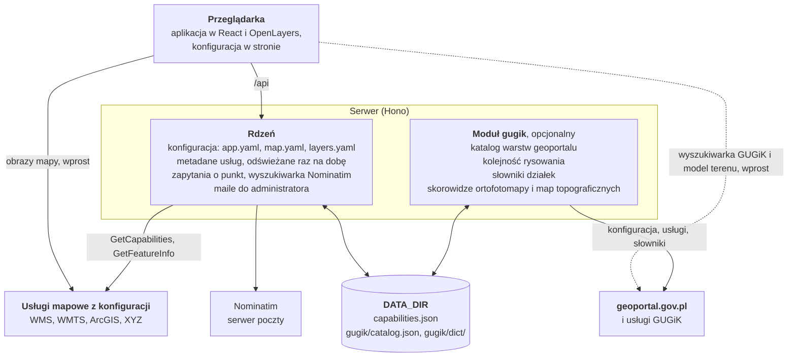
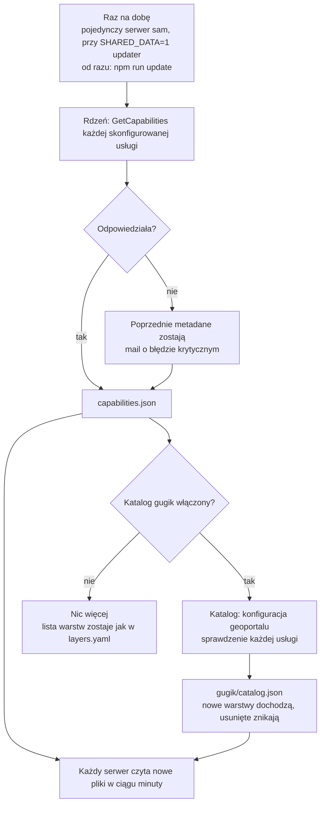

# Architektura

## Budowa

Moduł gugik i jego połączenia działają tylko, gdy włącza go `app.yaml`. Linia przerywana to jego wyszukiwarka i wysokości terenu, o które przeglądarka pyta wprost.

- `src/`: aplikacja w React 19, TypeScript i OpenLayers 10, style w Tailwind CSS. Konfigurację dostaje w samej stronie (`src/config/runtime.ts`), bez dodatkowego zapytania.
- `server/`: lekki serwer (Hono) bez bazy danych. Czyta konfigurację (`server/config/`), przechowuje i codziennie odświeża metadane usług, pośredniczy w zapytaniach o punkt i w wyszukiwarce Nominatim, wysyła maile do administratora (zgłoszenia i błędy krytyczne).
- `server/modules/gugik/` i `src/modules/gugik/`: opcjonalna integracja z geoportal.gov.pl: katalog wszystkich warstw geoportalu, kolejność rysowania, słowniki wyszukiwarki działek, skorowidze ortofotomapy i map topograficznych, wyszukiwarka GUGiK, wysokości i profil terenu, link do raportu o działce.
- `i18n/`: napisy interfejsu (pl, en); `skins/`: skórki dołączone do aplikacji.
- `Dockerfile`, `compose.yaml`, `deploy/caddy/`: kontenery z Caddy; `compose.proxy.yaml`, `deploy/nginx/`: wariant za istniejącym nginx.

Obrazy usług przeglądarka pobiera wprost od ich serwerów, od razu w układzie mapy, więc niczego nie przelicza. Przez serwer idą tylko zapytania o punkt (informacje o miejscu), słowniki, skorowidze i wyszukiwarka Nominatim.

## Dane i odświeżanie

| Dane                                                                                       | Gdzie                           | Odświeżane                                                      | Część                   |
| ------------------------------------------------------------------------------------------ | ------------------------------- | --------------------------------------------------------------- | ----------------------- |
| Metadane skonfigurowanych usług: zakresy skal, legendy, formaty informacji o miejscu, daty | `<DATA_DIR>/capabilities.json`  | raz na dobę, od razu przez `npm run update`                     | rdzeń                   |
| Kolejność rysowania z map geoportalu                                                       | `<DATA_DIR>/capabilities.json`  | razem z metadanymi                                              | gugik (`drawOrder`)     |
| Katalog warstw geoportalu                                                                  | `<DATA_DIR>/gugik/catalog.json` | razem z metadanymi                                              | gugik (`catalog`)       |
| Słowniki wyszukiwarki działek (TERYT)                                                      | `<DATA_DIR>/gugik/dict/`        | po 30 dniach (pusta lista po 6 godzinach), w tle przy zapytaniu | gugik (`search.parcel`) |
| Warstwy skorowidza ortofotomapy                                                            | pamięć                          | po 24 godzinach                                                 | gugik (`ortho`)         |
| Odpowiedzi skorowidzów ortofotomapy i map topograficznych dla punktu                       | pamięć                          | po godzinie                                                     | gugik (`ortho`, `topo`) |

„Raz na dobę” znaczy: pojedynczy serwer odświeża dane sam, a przy wspólnym katalogu danych (`SHARED_DATA=1`) robi to usługa `updater` w Compose. Każdy serwer czyta nowe pliki w ciągu minuty. Usługa, która nie odpowiada, zachowuje poprzednie metadane i jest błędem krytycznym, wysyłanym mailem do administratora (zob. [Wdrożenie](wdrozenie.md#błędy-krytyczne)).

Rdzeń nigdy nie zmienia listy warstw. To lista z `layers.yaml`, a odświeżanie tylko uzupełnia metadane wymienionych tam warstw: warstwa dodana w usłudze się nie pojawi, usunięta zostanie na liście.

Za geoportal.gov.pl nadąża tylko katalog modułu gugik. Warstwy dodane w geoportalu pojawiają się na liście, usunięte z niej znikają, a te, których usługa nie odpowiada, są wyszarzone z wyjaśnieniem. Przy wyłączonym module codzienne odświeżanie to tylko kilka zapytań o metadane skonfigurowanych usług.

## Bezpieczeństwo

API nie ma kont ani danych użytkowników.

- Serwer łączy się z adresem usługi tylko po sprawdzeniu, że to http(s) na typowym porcie, a host wskazuje adresy publiczne. Sprawdza to przy każdym przekierowaniu i odrzuca przekierowanie z https na http. Nie da się nim więc sięgnąć do sieci wewnętrznej.
- Zapytania o punkt przyjmują tylko usługi z konfiguracji lub z katalogu. Każdy parametr jest sprawdzany i budowany na nowo, a odpowiedzi są czytane z limitem rozmiaru i czasu.
- Limity zapytań na adres klienta i limit równoległych połączeń do usług źródłowych. Wyszukiwarka Nominatim wysyła najwyżej jedno zapytanie na sekundę. Szczegóły: [Wdrożenie](wdrozenie.md#działanie-serwera).
- `app.yaml`, `map.yaml` i `layers.yaml` nie mogą zawierać sekretów (klucze wyglądające na hasła i tokeny są odrzucane), a treści Markdown nie mogą wstawić HTML ani skryptów.
- Nagłówki: Content Security Policy budowana z konfiguracji, `frame-ancestors 'none'`, `nosniff`, `Referrer-Policy`, `Permissions-Policy`.

## Jakość

`npm run check` uruchamia kontrolę typów, ESLint (reguły TypeScript, React hooks, dostępności), Prettier i testy (Vitest): serwera w Node, aplikacji w jsdom. Testy sprawdzają między innymi:

- reguły WCAG biblioteki axe-core;
- kontrast każdej skórki;
- kompletność tłumaczeń;
- opis każdego pola konfiguracji w dokumentacji.

Każda zmiana ma test w tym samym commicie.

## Dane

Aplikacja pobiera dane na bieżąco z usług wskazanych w konfiguracji i ich nie przechowuje. Za dane odpowiadają ich wydawcy; informacje mają charakter poglądowy.
